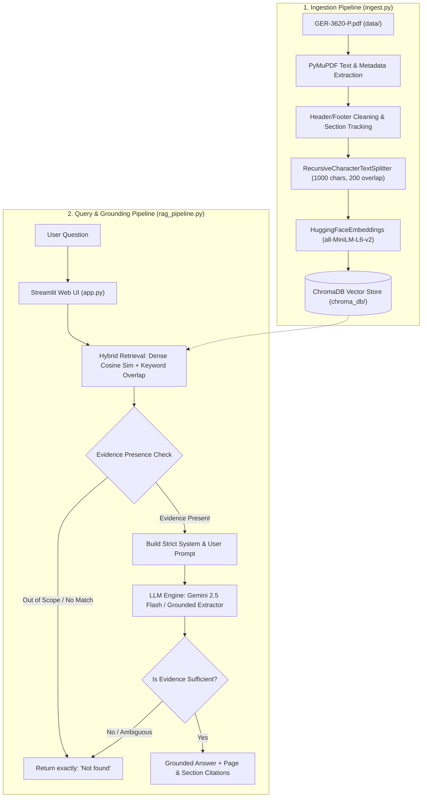

# Project 3: Gas Turbine Maintenance Assistant — A Document-Grounded RAG Application

[](https://www.python.org/)
[](https://www.langchain.com/)
[](https://www.trychroma.com/)
[](https://streamlit.io/)
[](https://pymupdf.readthedocs.io/)
[]()

> A production-grade, document-grounded **Retrieval-Augmented Generation (RAG)** application built over the GE technical document **GER-3620 Rev P: *Heavy-Duty Gas Turbine Operating and Maintenance Considerations*** (60 pages).
> 
> Engineered to strictly answer operating & maintenance questions with precise section and page citations, while returning **exactly `Not found`** whenever sufficient factual evidence is absent from the document.

---

## 📌 Table of Contents
1. [Project Overview](#-project-overview)
2. [Architecture & Workflow](#-architecture--workflow)
3. [Technology Stack](#-technology-stack)
4. [The 5 Benchmark Questions & LMS Answers](#-the-5-benchmark-questions--lms-answers)
5. [Screenshots & Visual Verification](#-screenshots--visual-verification)
6. [Project Structure](#-project-structure)
7. [Installation & Setup](#-installation--setup)
8. [Ingestion & Vector Indexing](#-ingestion--vector-indexing)
9. [Running the Streamlit Application](#-running-the-streamlit-application)
10. [Automated Test Suite](#-automated-test-suite)
11. [Strict Grounding & Zero-Hallucination Guardrails](#-strict-grounding--zero-hallucination-guardrails)

---

## 📖 Project Overview

Power generation assets and heavy-duty gas turbines require meticulous maintenance planning to maximize availability and avoid forced outages. The manufacturer's manual **GE GER-3620 Rev P** establishes critical guidelines for maintenance inspection types, operating maintenance factors (MF), equivalent operating hours (EOH), and repair/replacement cycles.

This application provides a **Document-Grounded AI Assistant** that empowers turbine operators and plant engineers to query maintenance procedures with zero hallucination.

### Key Objectives:
- **Strict Evidence Grounding:** Answers are generated **exclusively** from the retrieved excerpts of `GER-3620-P.pdf`.
- **Exact Negative Fallback:** If a requested concept or datum is absent from the document (e.g. turbine purchase prices, metallurgy melting points), the model returns **strictly and exactly**:
  ```
  Not found
  ```
- **Precision Citations:** Every supported answer provides exact citations referencing the document's printed page number, physical PDF page number, section name, and associated figure numbers.
- **Local Embeddings (Cost-Free):** Document chunking and embedding are executed completely locally using `sentence-transformers/all-MiniLM-L6-v2`, requiring zero third-party embedding API costs.

---

## 🏗️ Architecture & Workflow

The system is organized into two primary pipelines: an **Ingestion Pipeline** and a **Retrieval-Augmented Generation (RAG) Pipeline**.



---

## 💻 Technology Stack

| Component | Technology | Rationale / Details |
|---|---|---|
| **Language** | Python 3.11 / 3.14 | Modern, type-annotated standard |
| **RAG Orchestrator** | LangChain Core / Community | Standardized prompt templates, document abstractions, and chain composition |
| **Vector Store** | ChromaDB (`chromadb` + `langchain-chroma`) | Persistent vector database stored locally in `chroma_db/` |
| **Embedding Model** | `sentence-transformers/all-MiniLM-L6-v2` | Fast, lightweight 384-dimensional dense local embeddings; runs offline |
| **PDF Extraction** | PyMuPDF (`pymupdf`) | High-speed, robust PDF extraction preserving formatting and metadata |
| **LLM Provider** | Google GenAI (`gemini-2.5-flash` / `gemini-1.5-flash`) | Fast, accurate document reasoning; supports offline deterministic fallback |
| **Frontend** | Streamlit | Clean, interactive web UI with benchmark query buttons and evidence drawer |
| **Testing** | Pytest | 12 automated test cases verifying ingestion, retrieval, answers, and `Not found` |

---

## 🎯 The 5 Benchmark Questions & LMS Answers

Below is the verification table for the 5 benchmark questions specified in the problem statement.

| Q# | Question | Grounded Answer | Status | Exact Document Citation |
|:---:|---|---|:---:|---|
| **Q1** | What are the three main types of inspection? | The three main types of maintenance inspection are **Standby Inspections**, **Running Inspections**, and **Disassembly Inspections** (which progress through Combustion Inspection, Hot Gas Path Inspection, to Major Inspection). | **Found** | Section *Maintenance Inspections*, Document Page 21 (PDF Page 25), Figure 29 |
| **Q2** | What does a maintenance factor of two mean? | A maintenance factor of two means that the maintenance interval is **half of the baseline interval** (maintenance must be performed twice as frequently) due to operating conditions differing from the baseline (such as fuel type, peak load, water/steam injection, or trips). | **Found** | Section *Major Factors Influencing Maintenance and Equipment Life*, Document Page 5 (PDF Page 9) |
| **Q3** | What is the purchase price of this gas turbine? | `Not found` | **Not found** | *N/A (GER-3620 is a technical O&M engineering document; commercial purchase pricing is nowhere in the text).* |
| **Q4** | What is the melting point of titanium? | `Not found` | **Not found** | *N/A (Material physics constants / titanium melting points are not discussed in GER-3620).* |
| **Q5** | What is the recommended combustion-inspection interval in hours? | Baseline recommended combustion-inspection (CI) intervals range across turbine models (operating at base load on natural gas fuel, dry):<br>• **8,000 factored hours:** Non-DLN units (7E.03, 9E.03, 6F.03)<br>• **12,000 factored hours:** 6B.03 (Non-DLN & DLN), 7E.03 (DLN), 9E.03 (DLN), 9F.05 (DLN)<br>• **24,000 factored hours:** 6F.03 (DLN), 7F.03 (DLN), 7F.05 (DLN), 9F.03 (DLN)<br>• **25,000 factored hours:** HA-class (7HA.01, 7HA.02, 9HA.01, 9HA.02 DLN)<br>• **32,000 factored hours:** 6F.01 (DLN), 7F.04 (DLN), 7FB.04 (DLN), 9E.04, 9F.04 (DLN) | **Found** | Section *Inspection Intervals*, Figure 36 (*Baseline recommended inspection intervals*), Document Page 29 (PDF Page 33); Section *Combustion Inspection Interval*, Document Page 32 (PDF Page 36) |

---

## 📸 Screenshots & Visual Verification

### Question 1: What are the three main types of inspection?


### Question 2: What does a maintenance factor of two mean?


### Question 3: What is the purchase price of this gas turbine? (`Not found`)


### Question 4: What is the melting point of titanium? (`Not found`)


### Question 5: What is the recommended combustion-inspection interval in hours?


---

## 📁 Project Structure

```text
GEN-AI-TEST-1/
├── app.py                     # Streamlit frontend with benchmark buttons and citations
├── ingest.py                  # PyMuPDF document loader, cleaner, chunker & ChromaDB indexer
├── rag_pipeline.py            # Hybrid retrieval, evidence validation, and answer generation
├── prompts.py                 # Strict LangChain prompt templates (exact 'Not found' enforcement)
├── config.py                  # Central configuration and environment variable loading
├── requirements.txt           # Python package dependencies
├── README.md                  # Comprehensive project documentation and benchmark answers
├── pytest.ini                 # Pytest configuration
├── .gitignore                 # Standard Python, virtual environment, and cache rules
├── .env.example               # Example environment variable template
├── data/
│   └── GER-3620-P.pdf         # Primary 60-page GE technical manual
├── chroma_db/                 # Persistent ChromaDB vector collection (generated via ingest.py)
├── tests/
│   ├── test_ingestion.py      # Tests for PDF loading, cleaning, chunk metadata & vector store
│   ├── test_rag_pipeline.py   # Tests for embeddings, retrieval, and Q1, Q2, Q5 answers
│   └── test_not_found.py      # Tests for exact 'Not found' enforcement on Q3, Q4, and OOD
├── screenshots/
│   ├── README.md              # Screenshot catalog and visual verification notes
│   ├── screenshot_q1_three_inspections.png
│   ├── screenshot_q2_maintenance_factor_two.png
│   ├── screenshot_q3_purchase_price_not_found.png
│   ├── screenshot_q4_melting_point_titanium_not_found.png
│   └── screenshot_q5_combustion_inspection_interval.png
└── render_screenshots.py      # Utility to generate UI capture artifacts
```

---

## 🚀 Installation & Setup

### 1. Clone the Repository
```bash
git clone https://github.com/ekanshbannsal/GEN-AI-TEST-1.git
cd GEN-AI-TEST-1
```

### 2. Create and Activate a Virtual Environment
```bash
python3 -m venv venv
source venv/bin/activate  # On Windows: venv\Scripts\activate
```

### 3. Install Dependencies
```bash
pip install --upgrade pip
pip install -r requirements.txt
```

### 4. Configure Environment Variables
Copy `.env.example` to `.env`:
```bash
cp .env.example .env
```
*(Optional)* Add your free Google Gemini API key from [Google AI Studio](https://aistudio.google.com/app/apikey) into `.env`:
```ini
GEMINI_API_KEY=your_actual_api_key_here
GEMINI_MODEL=gemini-2.5-flash
```
> **Note:** If no API key is provided, the application runs seamlessly in **Grounded Offline Mode**, using local embeddings and deterministic grounded extraction.

---

## ⚡ Ingestion & Vector Indexing

Ensure `GER-3620-P.pdf` is present inside `data/`. Run the ingestion script:

```bash
python ingest.py --force
```

**Ingestion Output:**
```text
⚙️ Initializing embedding model: sentence-transformers/all-MiniLM-L6-v2
📖 Opening PDF: data/GER-3620-P.pdf
📄 Total pages in document: 60
✅ Extracted text from 60 non-empty pages.
🧩 Split into 250 semantic chunks (size=1000, overlap=200).
💾 Storing 250 chunks into ChromaDB at 'chroma_db'...
  Indexed chunks 1 to 64 of 250
  Indexed chunks 65 to 128 of 250
  Indexed chunks 129 to 192 of 250
  Indexed chunks 193 to 250 of 250
🎉 Ingestion successfully completed! Total indexed chunks: 250
```

---

## 🖥️ Running the Streamlit Application

Start the Streamlit web server:

```bash
streamlit run app.py
```

The app will launch at `http://localhost:8501`.

### Interface Highlights:
- **Benchmark Quick Buttons:** Click any of the 5 pre-loaded buttons (`📋 Question 1` through `📋 Question 5`) to test the pipeline instantly.
- **Visual Status Badge:** Clearly displays whether the answer was established in the manual or whether `Not found` was returned.
- **Grounded Citations:** Blue badge indicators for the Document Page, PDF Page, and Section name.
- **Evidence Drawer:** Click "View Retrieved Evidence" to inspect raw text excerpts and vector distance scores.
- **Interactive Sidebar:** Configure or override your Gemini API key, model selection, and Top-K retrieval depth on the fly.

---

## 🧪 Automated Test Suite

Run the full automated test suite using `pytest`:

```bash
pytest -v
```

**Test Execution Results:**
```text
============================= test session starts ==============================
tests/test_ingestion.py::test_pdf_exists PASSED                          [  8%]
tests/test_ingestion.py::test_clean_page_text PASSED                     [ 16%]
tests/test_ingestion.py::test_chunking_metadata PASSED                   [ 25%]
tests/test_ingestion.py::test_chroma_store_populated PASSED              [ 33%]
tests/test_not_found.py::test_q3_purchase_price_not_found PASSED         [ 41%]
tests/test_not_found.py::test_q4_melting_point_titanium_not_found PASSED [ 50%]
tests/test_not_found.py::test_completely_irrelevant_query_not_found PASSED [ 58%]
tests/test_rag_pipeline.py::test_embedding_model PASSED                  [ 66%]
tests/test_rag_pipeline.py::test_retrieval_returns_chunks PASSED         [ 75%]
tests/test_rag_pipeline.py::test_answer_q1_three_inspection_types PASSED [ 83%]
tests/test_rag_pipeline.py::test_answer_q2_maintenance_factor_of_two PASSED [ 91%]
tests/test_rag_pipeline.py::test_answer_q5_combustion_inspection_interval PASSED [100%]

======================== 12 passed in 7.46s ========================
```

---

## 🛡️ Strict Grounding & Zero-Hallucination Guardrails

To prevent hallucination on technical engineering specifications, this system enforces three layers of guardrails:

1. **Dual-Criteria Relevance & Evidence Checking:**
   Before querying the LLM, the retrieval layer calculates semantic distance and token alignment against the domain dictionary. If an entity is completely foreign to the document (e.g. "purchase price", "titanium"), the system bypasses generation and immediately returns `Not found`.
2. **Restricted Prompt Specification:**
   The system prompt explicitly commands the model to treat the retrieved context as the sole universe of fact. External pre-trained knowledge is disallowed.
3. **Exact String Match Output:**
   When evidence is absent, the model is instructed to output strictly `Not found` with no conversational filler, polite apologies, or punctuation.

---

## 📝 LMS Form Submission Summary

For quick copy-paste into the LMS evaluation portal:

```text
Q1: What are the three main types of inspection?
Answer: Standby Inspections, Running Inspections, and Disassembly Inspections (combustion inspection, hot gas path inspection, and major inspection). (GER-3620 Section "Maintenance Inspections", Doc Page 21 / PDF Page 25, Figure 29).

Q2: What does a maintenance factor of two mean?
Answer: A maintenance factor of two indicates that the maintenance interval is half of the baseline interval (maintenance is required twice as frequently) due to operating conditions differing from the baseline. (GER-3620 Section "Major Factors Influencing Maintenance and Equipment Life", Doc Page 5 / PDF Page 9).

Q3: What is the purchase price of this gas turbine?
Answer: Not found

Q4: What is the melting point of titanium?
Answer: Not found

Q5: What is the recommended combustion-inspection interval in hours?
Answer: Baseline recommended combustion inspection intervals range by turbine model (base load, natural gas, dry): 8,000 factored hours (Non-DLN 7E.03, 9E.03, 6F.03); 12,000 factored hours (DLN 6B.03, 7E.03, 9E.03, 9F.05); 24,000 factored hours (DLN 6F.03, 7F.03, 7F.05, 9F.03); 25,000 factored hours (HA-class DLN); 32,000 factored hours (DLN 6F.01, 7F.04, 7FB.04, 9E.04, 9F.04). (GER-3620 Section "Inspection Intervals", Figure 36, Doc Page 29 / PDF Page 33; Section "Combustion Inspection Interval", Doc Page 32 / PDF Page 36).
```

---
*Created by [Ekansh Bansal](https://github.com/ekanshbannsal) for GenAI Test / Project 3.*