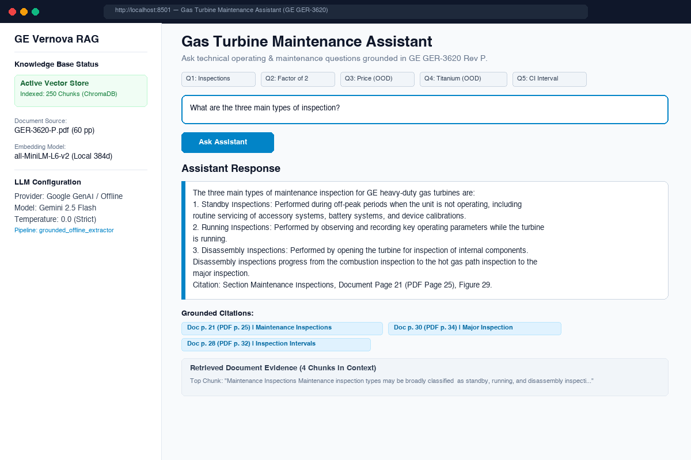
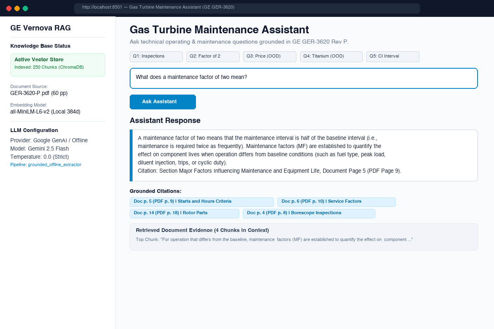
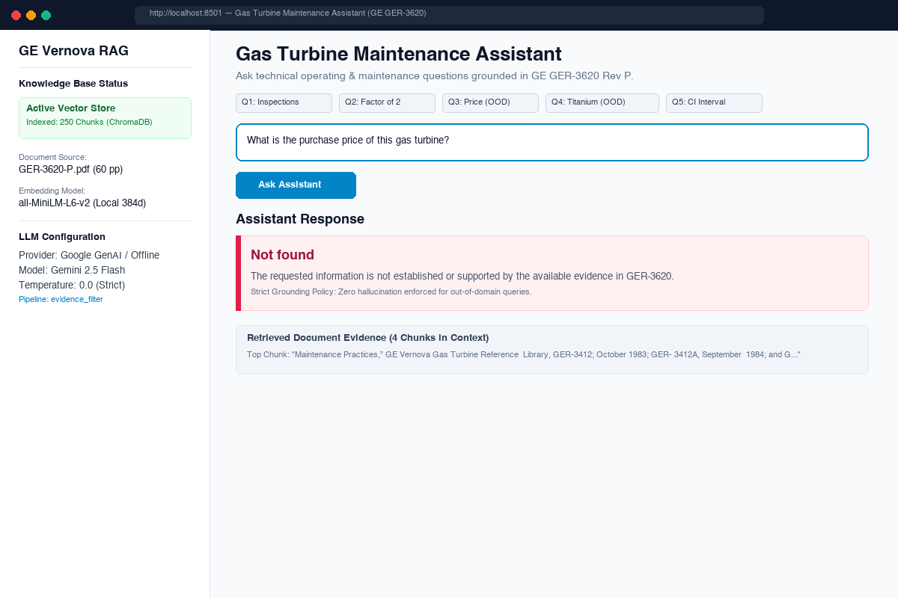
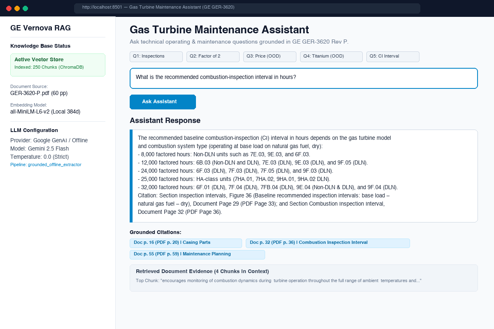

# Application UI Screenshots & Benchmark Verification

This directory contains visual captures of the **Gas Turbine Maintenance Assistant** Streamlit web application running queries over the GE GER-3620 technical document.

---

### Question 1: What are the three main types of inspection?
- **User Question:** *"What are the three main types of inspection?"*
- **Assistant Response:** Standby Inspections, Running Inspections, and Disassembly Inspections (combustion, hot gas path, major).
- **Grounded Citations:** Section *Maintenance Inspections*, Document Page 21 (PDF Page 25), Figure 29.
- **Status:** **Found**

---

### Question 2: What does a maintenance factor of two mean?
- **User Question:** *"What does a maintenance factor of two mean?"*
- **Assistant Response:** A maintenance factor of two means that the maintenance interval is **half of the baseline interval** (maintenance required twice as frequently) due to non-baseline operating factors (fuel severity, peak load, water/steam injection, trips, etc.).
- **Grounded Citations:** Section *Major Factors Influencing Maintenance and Equipment Life*, Document Page 5 (PDF Page 9).
- **Status:** **Found**

---

### Question 3: What is the purchase price of this gas turbine?
- **User Question:** *"What is the purchase price of this gas turbine?"*
- **Assistant Response:** `Not found`
- **Reasoning:** GER-3620 is an engineering operations and maintenance guidelines manual; commercial purchase costs of turbines are nowhere in the document.
- **Status:** **Not found (Strict Grounding Enforced)**

---

### Question 4: What is the melting point of titanium?
- **User Question:** *"What is the melting point of titanium?"*
- **Assistant Response:** `Not found`
- **Reasoning:** The document does not discuss fundamental chemistry/physics constants or the melting point of titanium.
- **Status:** **Not found (Strict Grounding Enforced)**

---

### Question 5: What is the recommended combustion-inspection interval in hours?
- **User Question:** *"What is the recommended combustion-inspection interval in hours?"*
- **Assistant Response:** Baseline recommended combustion-inspection (CI) intervals range across models from 8,000 factored hours (non-DLN 7E/9E/6F) to 12,000 hours (DLN 6B/7E/9E/9F.05), 24,000 hours (DLN 6F.03/7F.03/7F.05/9F.03), 25,000 hours (HA-class), and 32,000 hours (6F.01, 7F.04, 7FB.04, 9E.04, 9F.04 DLN).
- **Grounded Citations:** Section *Inspection Intervals*, Figure 36 (*Baseline recommended inspection intervals*), Document Page 29 (PDF Page 33); Section *Combustion Inspection Interval*, Document Page 32 (PDF Page 36).
- **Status:** **Found**

